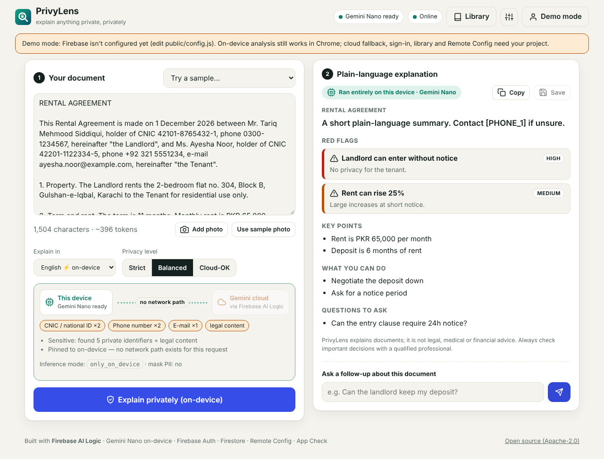

# PrivyLens — explain anything private, privately

> Paste a contract, a lab report, a bank SMS — or snap a photo of a bill — and get a plain-language explanation with **red flags, action items and questions to ask**.
> **Gemini Nano runs it on your device.** The cloud is used only when it must, and then **private identifiers are masked on-device first**. Orchestrated end-to-end with **Firebase AI Logic**.



## Why it matters

People are asked to sign rental agreements, read lab results and judge "urgent" bank messages — exactly the documents they should *not* paste into a cloud chatbot. PrivyLens makes the private path the default path:

| | |
|---|---|
| **On-device first** | Gemini Nano (Chrome built-in AI) via Firebase AI Logic hybrid inference — free, instant, works offline. |
| **A Privacy Router you can see** | Before every request the app shows *where* the document may be read and *why*, and previews exactly what could leave the device. |
| **Mask, don't leak** | CNIC, cards (Luhn), IBAN (mod-97), phones, e-mails are replaced by `[CNIC_1]`-style tokens before any cloud call, and restored **locally** in the answer. |
| **Fits Nano's small window** | Long documents are read in parts on-device (map-reduce) instead of being shipped to the cloud. |
| **Urdu / Roman Urdu** | Languages Nano can't write yet (Urdu, Roman Urdu, Hindi, Arabic) are routed to the cloud — with masking — automatically. |
| **Photos stay local** | Photo input is read by the on-device multimodal model and never uploaded in Balanced/Strict mode. |

## How Firebase AI Logic is used (runtime, not just a README mention)

`public/js/ai.js` calls, at runtime:

```js
import { getGenerativeModel, InferenceMode, Schema } from "firebase/ai";
const model = getGenerativeModel(ai, {
  mode: InferenceMode.ONLY_ON_DEVICE,          // chosen per request by the Privacy Router
  onDeviceParams: { createOptions, promptOptions: { responseConstraint: ANALYSIS_SCHEMA } },
  inCloudParams:  { model: policy.cloudModel, generationConfig: { responseMimeType: "application/json", responseSchema: ANALYSIS_SCHEMA } },
});
const result = await model.generateContent([prompt, ...imageParts]);
result.response.inferenceSource;               // "on_device" | "in_cloud"  → shown as a badge
await model.initializeDeviceModel(onProgress); // user-initiated Gemini Nano download
await model.generateContentStream(prompt);     // streamed follow-up answers
```

All four inference modes are used: `ONLY_ON_DEVICE` (sensitive / strict / offline), `PREFER_ON_DEVICE` (nothing sensitive), `PREFER_IN_CLOUD` (Cloud-OK + long), `ONLY_IN_CLOUD` (language/size gaps, always masked). One JSON schema drives both the cloud `responseSchema` and the on-device `responseConstraint`.

| Firebase product | Role in PrivyLens |
|---|---|
| **AI Logic** | Hybrid on-device (Gemini Nano) + cloud (Gemini) inference, structured output, streaming, multimodal input |
| **App Check** | reCAPTCHA provider + debug token, initialised before any other product (required by AI Logic) |
| **Remote Config** | The routing policy: on-device languages, size limits, `force_mode` kill-switch, cloud model, PII masking on/off |
| **Authentication** | Anonymous start (zero friction) → upgrade to Google via account linking |
| **Firestore** | Private library of *explanations only* + "Privacy Ledger" (atomic counters: on-device vs cloud vs items masked); offline persistence; locked-down security rules |

## Architecture

```
                     ┌──────────── Remote Config (policy) ────────────┐
 text / photo ─► PII + topic detector ─► PRIVACY ROUTER ─► mode + {mask?, chunk?}
   (local)        (pii.js)               (router.js)              │
                                                                  ▼
                         Firebase AI Logic  getGenerativeModel(ai, {mode, onDeviceParams, inCloudParams})
                          ├─ on-device: Chrome Prompt API → Gemini Nano (text + image, JSON constraint)
                          └─ in-cloud : Gemini via App Check-protected backend (masked text only)
                                                                  │
                         restore [CNIC_1] tokens locally ◄────────┘ ─► render (textContent only) ─► Firestore (explanation only)
```

Decision table (`router.js`, covered by unit tests):

| Situation | Mode | Notes |
|---|---|---|
| Strict | `ONLY_ON_DEVICE` | blocked if Nano can't do it |
| Offline | `ONLY_ON_DEVICE` | nothing can leave the device |
| Balanced + sensitive (PII / medical / financial / legal / photo) | `ONLY_ON_DEVICE` | original text, no network path |
| Balanced + nothing sensitive | `PREFER_ON_DEVICE` | silent cloud fallback; text masked anyway |
| Language / script / size Nano can't handle | `ONLY_IN_CLOUD` | PII masked first; photos blocked |
| Cloud-OK | `PREFER_ON_DEVICE` / `PREFER_IN_CLOUD` | masked |
| Remote Config `force_mode` | as set | kill-switch; masking still applies |

## Run it

Requirements: **desktop Chrome 139+** for on-device mode (other browsers fall back to the cloud). Node 20+ only for the dev server/tests — the app itself has **no build step** (Firebase SDK 13 is loaded through an import map; the import lines are identical to an npm setup).

1. **Create a Firebase project** → add a **Web app** → copy the config into `public/config.js`.
2. **Firebase AI Logic**: Console → Build → AI Logic → Get started → *Gemini Developer API*.
3. **App Check**: register the web app (reCAPTCHA v3 or Enterprise), paste the site key in `config.js`, and **enforce** it for AI Logic (and Firestore). For local dev / judging add a **debug token** (App Check → Apps → ⋮ → *Manage debug tokens*) and paste it in `appCheckConfig.debugToken`. On `localhost` a token is auto-generated and printed in the console if you leave it empty.
4. **Authentication**: enable *Anonymous* and *Google*.
5. **Firestore**: create a database, then deploy rules; **Remote Config**: deploy the template.
   ```bash
   npm i -g firebase-tools && firebase login
   cp .firebaserc.example .firebaserc   # put your project id in it
   firebase deploy --only firestore,remoteconfig,hosting
   ```
6. **Local dev**: `npm start` → http://localhost:5173
7. **Enable Gemini Nano** in Chrome: open `chrome://flags/#prompt-api-for-gemini-nano-multimodal-input` → *Enabled* → restart → press the **Nano chip** in PrivyLens to download the model (one time).

Without step 1 the app still runs in **demo mode** (on-device only; no sign-in, library or cloud).

### Things to try (judges)

* Load the **Rental agreement** sample → watch the router pin it to `only_on_device`; turn on airplane mode — it still works.
* Load the **Urdu bill notice** → routed to the cloud, but open *"Preview exactly what could leave this device"*: IDs are tokens. The answer shows the real numbers again, locally.
* Load the **Long gym contract** → read in parts on-device; the buried auto-renewal trap is found.
* **Add sample photo** → read by the on-device multimodal model.
* Change `force_mode` in Remote Config to `only_in_cloud` → *Settings → Refresh Remote Config* → the router obeys (kill-switch), still masking.
* Save an explanation → **Library** → the **Privacy Ledger** shows on-device vs cloud counts.

## Tests

```bash
npm test                          # 34 unit tests: PII detection/redaction, router decisions, chunking, prompts
npm run check                     # syntax-check every browser module
python3 test/e2e/run_e2e.py       # headless-Chrome UI test with a Firebase SDK test double (needs Playwright)
```
The e2e test asserts what the app asks the SDK to do: the inference mode per scenario, that cloud prompts contain **no** raw CNIC/phone, that chunking issues several on-device calls, that Firestore never receives raw text, and that Remote Config reaches the SDK call.

## Honest limitations

* PII detection is pattern-based (IDs, cards, IBAN, phones, e-mails). **Names and street addresses are not detected**; topic sensitivity is a keyword heuristic.
* On-device inference runs on Chrome's built-in model; Chrome, not the app, decides which Gemini Nano version is installed. The app is model-agnostic.
* On-device models are single-turn: follow-ups re-send the most relevant excerpts instead of using chat history. Firebase console AI monitoring shows no data for on-device calls.
* PrivyLens explains; it does not give legal, medical or financial advice.

## Repository layout

```
public/            static app (Firebase Hosting root)
  index.html       UI + import map
  config.js        YOUR Firebase settings
  js/ai.js         Firebase AI Logic hybrid calls  ← core
  js/router.js     Privacy Router (pure, tested)
  js/pii.js        PII/topic detection + masking (pure, tested)
  js/policy.js     Remote Config policy        js/auth.js    Authentication
  js/store.js      Firestore library + ledger  js/firebase.js App Check + SDK init
  sw.js            offline app shell
firestore.rules · remoteconfig.template.json · firebase.json
test/              unit tests + headless e2e
```

## License

Apache-2.0 — see [LICENSE](LICENSE).
